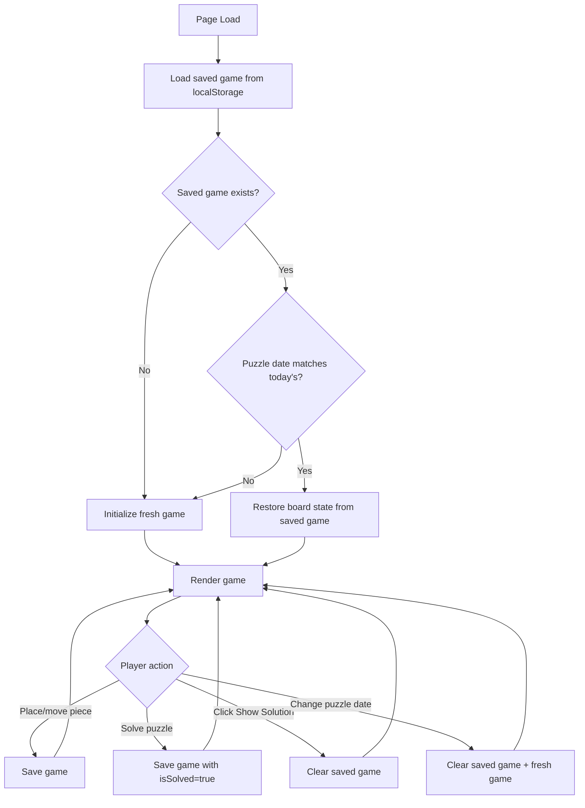

# Saved Game (Local Storage)

Persist game state to localStorage so players can resume their progress after page reload. Only the player's own progress is saved - after a revealed solution, no saved game is kept.

The code still uses the word "session" for this feature (`SessionData`, `useGameSession`, the storage key). The glossary calls it the saved game, because "session" also means the login session.

## Saved Game Data Model

```typescript
interface SessionData {
  date: PuzzleDate;      // { month, day }
  pieces: Piece[];       // Piece state (position, rotation, flips, isLocked, placedSeq)
  isSolved: boolean;     // Whether the player solved the puzzle
}
```

LocalStorage key: `calendar-puzzle-session`

## Saved Game Flow



## Behavior Summary

| Action | Saved Game Behavior |
|--------|---------------------|
| Place/move piece | Save game |
| Player solves puzzle | Save with `isSolved: true` |
| Click "Show Solution" | Clear saved game |
| Change puzzle date | Clear saved game |
| Page reload (puzzle date matches today's) | Restore saved game |
| Page reload (puzzle date differs) | Fresh game |

## Edge Cases

- **localStorage disabled**: All operations wrapped in try/catch, gracefully degrade to no persistence
- **Corrupted data**: `JSON.parse` in try/catch, return null on failure
- **Revealed solution**: Clear saved game, don't persist - the player starts fresh on reload
- **Hint used**: Hint pieces have `isLocked: true`, this is preserved in the saved game
